# Tài liệu & DEMO: Tích Hợp GitHub Actions (`testing-tool-js` ↔ `qa-analyzer` — Project `ES`)

Thư mục này chứa toàn bộ tài liệu kiến trúc, cấu hình, script chạy thử và bộ hình ảnh / video màn hình thực tế cho luồng CI/CD **GitHub Actions** giữa repository `testing-tool-js` (đã triển khai demo tại [`danhhoangjunior/testing-tool-js-demo`](https://github.com/danhhoangjunior/testing-tool-js-demo) & [`danhjunior/testing-tool-js-demo`](https://github.com/danhjunior/testing-tool-js-demo)) và ứng dụng Jira Cloud `qa-analyzer` (`https://pipevo.atlassian.net/jira/software/projects/ES/...`, project key **`ES`**).

## Cấu trúc thư mục `docs/github-actions/`

| File / Thư mục | Mô tả |
| :--- | :--- |
| [`README.md`](./README.md) | Tài liệu phân tích luồng hoạt động, hướng dẫn cài đặt & hình ảnh DEMO thực tế từng bước |
| [`.env.example`](./.env.example) | Mẫu cấu hình `.env` để đẩy kết quả từ local lên Forge Web Trigger của project `ES` |
| [`demo-github-actions.sh`](./demo-github-actions.sh) | Script chạy Demo thực tế (`sh docs/github-actions/demo-github-actions.sh`) |
| [`media/demo_github_actions_flow.mp4`](./media/demo_github_actions_flow.mp4) | Video ghi màn hình toàn trình 6 bước (MP4) |
| [`media/demo_step1_jira_setup.png`](./media/demo_step1_jira_setup.png) | Ảnh Bước 1: Màn hình CI/CD Pipeline → GitHub Actions → Setup trên Jira (`ES`) |
| [`media/demo_step2_github_secrets.png`](./media/demo_step2_github_secrets.png) | Ảnh Bước 2: Cấu hình thực tế GitHub Secrets (`URL`, `TOKEN`) & Variable (`JIRA_PROJECT_KEY=ES`) |
| [`media/demo_step3_github_actions_run.png`](./media/demo_step3_github_actions_run.png) | Ảnh Bước 3: GitHub Actions Cloud Runner thực thi job `test` (`AiTestingTool Vitest #2`) và nhận `HTTP 201` |
| [`media/demo_step4_terminal_execution.png`](./media/demo_step4_terminal_execution.png) | Ảnh Bước 4: Kết quả thực thi script Demo trên Terminal |
| [`media/demo_step5_jira_builds_sync.png`](./media/demo_step5_jira_builds_sync.png) | Ảnh Bước 5: Màn hình Jira `Empty Space (ES)` → `Test design` với các Suites & Automated TestCases (`ES-1024..ES-1057`) |
| [`media/demo_jira_test_execution.png`](./media/demo_jira_test_execution.png) | Ảnh Bước 6: Màn hình Jira `Empty Space (ES)` → `Test execution` với các bản ghi `Automated` `PASSED` (`ES-1071..ES-1076`) |
| [`media/demo_playwright_step1_jira_setup.png`](./media/demo_playwright_step1_jira_setup.png) | Ảnh Playwright Bước 1: Màn hình CI/CD Pipeline → GitHub Actions → Setup → Playwright trên Jira (`ES`) |
| [`media/demo_playwright_step3_github_actions_run.png`](./media/demo_playwright_step3_github_actions_run.png) | Ảnh Playwright Bước 2: GitHub Actions Cloud Runner thực thi `AiTestingTool Playwright #1` (`Run ID 39618287339`) và nhận `HTTP 201` |
| [`media/demo_playwright_step5_jira_test_design.png`](./media/demo_playwright_step5_jira_test_design.png) | Ảnh Playwright Bước 3: Cây thư mục `E-commerce` (`Checkout`, `Inventory`, `Shopping Cart`) và TestCase `ES-1087` trên Jira `Test design` |
| [`media/demo_playwright_jira_test_execution.png`](./media/demo_playwright_jira_test_execution.png) | Ảnh Playwright Bước 4: Các bản ghi E2E `Automated` `PASSED` (`ES-1085..ES-1101`) trên Jira `Test execution` |
| [`media/demo_playwright_test_pad_steps.png`](./media/demo_playwright_test_pad_steps.png) | Ảnh Playwright Bước 5: Các bước `await test.step(...)` hiển thị trực tiếp trong Jira Test Pad (`ES-1090`) |

---

## 1. Sơ đồ luồng hoạt động End-to-End

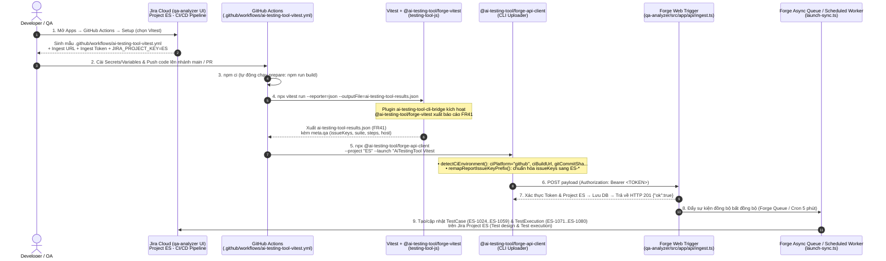

---

## 2. Hình ảnh DEMO Thực Tế Từng Bước

### Bước 1: Lấy cấu hình CI/CD Template trên Jira (`Project ES`)
Trên Jira (`pipevo.atlassian.net` → Project **`ES`** → **Apps → GitHub Actions → Setup**), chọn framework **Vitest** để nhận mẫu [`.github/workflows/ai-testing-tool-vitest.yml`](../../.github/workflows/ai-testing-tool-vitest.yml) cùng `CI INGEST ENDPOINT` và `INGEST TOKEN`:

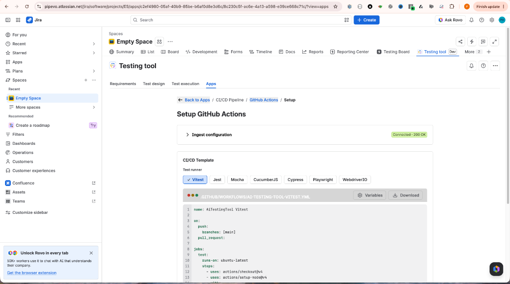

---

### Bước 2: Thiết lập GitHub Secrets & Variables thực tế trên GitHub
Khai báo `AI_TESTING_TOOL_INGEST_URL`, `AI_TESTING_TOOL_INGEST_TOKEN` (Repository Secrets), `JIRA_PROJECT_KEY = ES` (Repository Variable) trên GitHub (`Settings → Secrets and variables → Actions`):

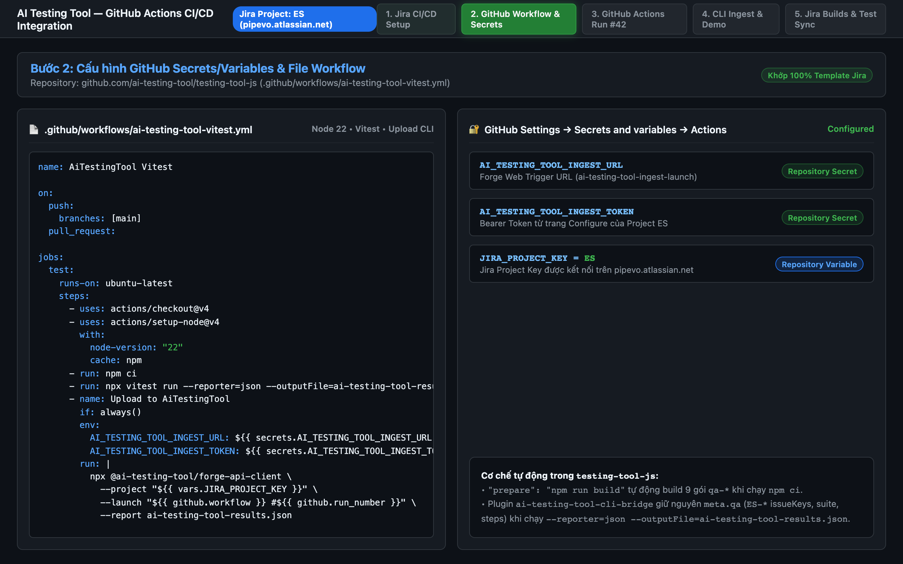

---

### Bước 3: GitHub Actions Cloud Runner thực thi Workflow `AiTestingTool Vitest #2`
- **Link lượt chạy thực tế:** [`https://github.com/danhhoangjunior/testing-tool-js-demo/actions/runs/39590640214/job/119190417344`](https://github.com/danhhoangjunior/testing-tool-js-demo/actions/runs/39590640214/job/119190417344)
- GitHub Actions chạy `npm ci`, chạy `npx vitest run --reporter=json --outputFile=ai-testing-tool-results.json` (`195` tests, `197` steps) và upload qua `@ai-testing-tool/forge-api-client` (`--project "ES" --launch "AiTestingTool Vitest #2"`), nhận phản hồi **`Ingest upload: 100% — Ingest accepted (HTTP 201)`**:

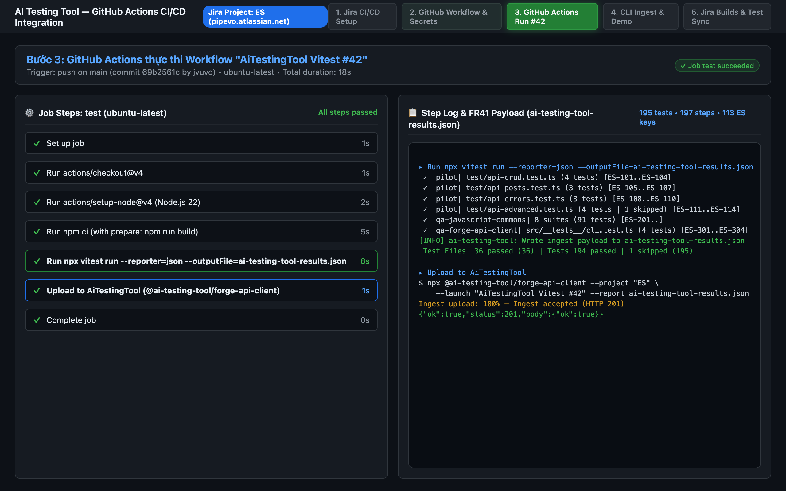

---

### Bước 4: Chạy lệnh Demo Thực Tế (`sh docs/github-actions/demo-github-actions.sh`)
Thực thi trực tiếp luồng GitHub Actions từ terminal:
```bash
sh docs/github-actions/demo-github-actions.sh
```

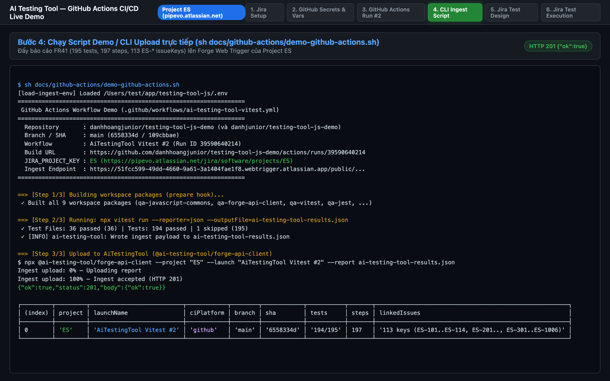

---

### Bước 5: Đồng bộ Suites & Automated Test Cases trên Jira (`Empty Space → Test design`)
Sau khi Forge Web Trigger (`ingest.ts`) trả về `HTTP 201 {"ok":true}`, worker `launch-sync.ts` tự động đồng bộ các Test Suites (`@ai-testing-tool/forge-api-client CLI`, `generateCiTemplate — all platforms × frameworks`, `Error Handling`...) và tạo các bản ghi **TestCase (`ES-1024` … `ES-1059`)** với loại **`Automated`** trên tab **Test design**:

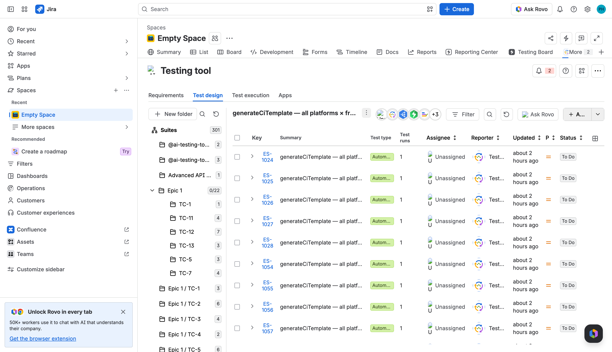

---

### Bước 6: Đồng bộ Kết quả Chạy Test trên Jira (`Empty Space → Test execution`)
Trên tab **Test execution** của project **`ES`**, các bản ghi **TestExecution (`ES-1071` … `ES-1080`)** được ghi nhận với loại **`Automated`** và trạng thái **`PASSED`**:

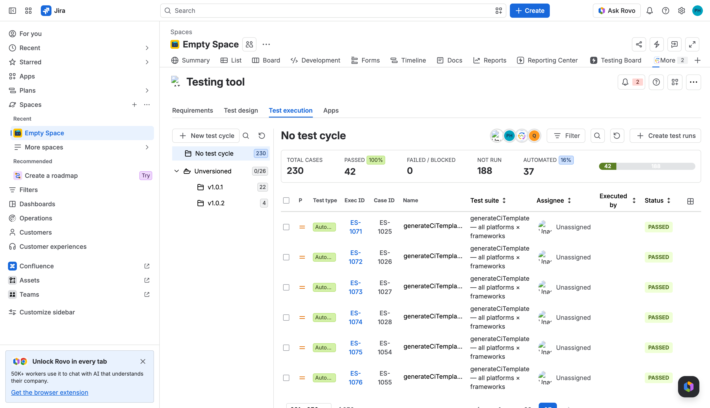

---

## 3. Luồng GitHub Actions với Playwright E2E (`AiTestingTool Playwright`)

Ngoài Vitest, dự án đã cấu hình và chạy thực tế workflow **Playwright E2E** ([`.github/workflows/ai-testing-tool-playwright.yml`](../../.github/workflows/ai-testing-tool-playwright.yml)) cùng [`playwright.config.js`](../../playwright.config.js) kiểm thử end-to-end trên trình duyệt Chromium (`https://www.saucedemo.com`) với 4 spec files (`login.spec.js`, `inventory.spec.js`, `cart.spec.js`, `checkout.spec.js` — **13 E2E tests, 30 native `test.step` steps**).

### 3.1. Lấy cấu hình Playwright trên Jira (`Setup GitHub Actions → Playwright`)
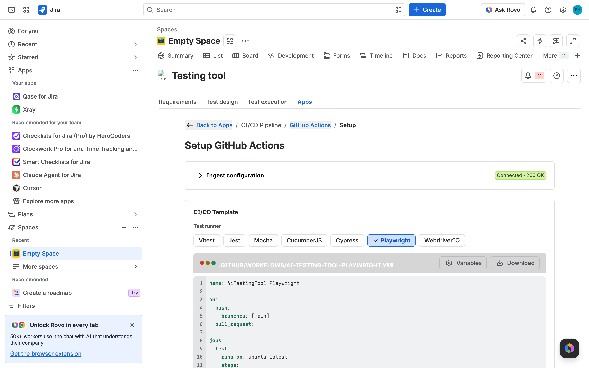

### 3.2. GitHub Actions Cloud Runner thực thi `AiTestingTool Playwright #1` (`HTTP 201`)
- **Link lượt chạy thực tế:** [`https://github.com/danhhoangjunior/testing-tool-js-demo/actions/runs/39618287339/job/119284723328`](https://github.com/danhhoangjunior/testing-tool-js-demo/actions/runs/39618287339/job/119284723328)
- Thực thi `npx playwright install --with-deps`, `npx playwright test --reporter=json > ai-testing-tool-results.json` và đẩy qua `npx @ai-testing-tool/forge-api-client` (tự động chuyển đổi báo cáo JSON gốc của Playwright sang chuẩn FR41 qua `convertPlaywrightJsonReport`), nhận phản hồi **`Ingest upload: 100% — Ingest accepted (HTTP 201)`**:

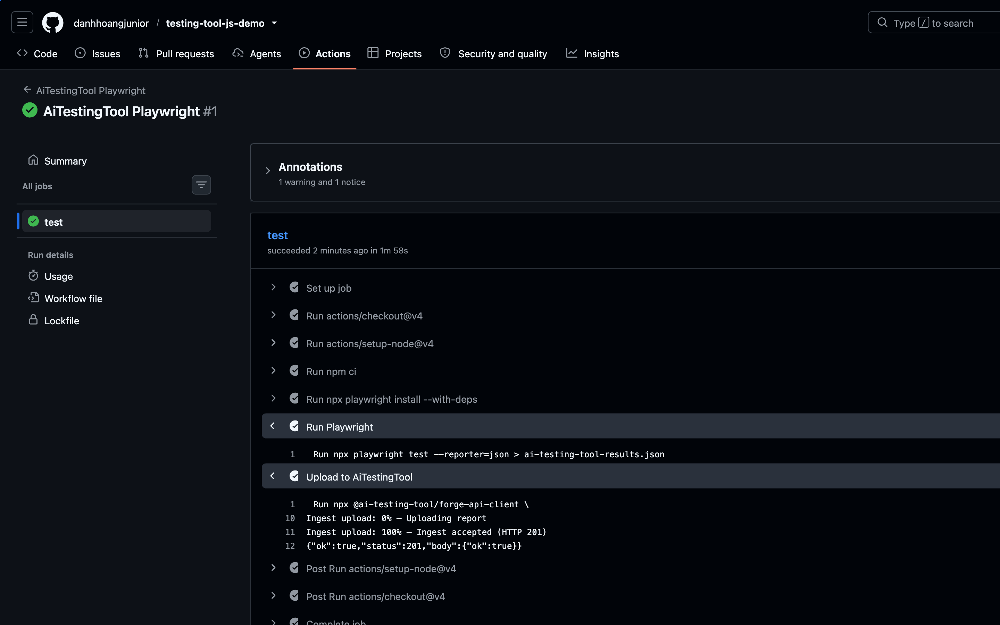

### 3.3. Đồng bộ Cây Thư Mục `E-commerce` & TestCase trên Jira (`Test design`)
Worker `launch-sync.ts` tự động tạo cây thư mục `E-commerce` (`Checkout` → `Complete Flow`, `Validation`, `Navigation`, `Demo`; `Inventory` → `Browsing`, `Sorting`, `Product Details`; `Shopping Cart` → `Add Items`, `Remove Items`, `Multiple Items`) và liên kết TestCase `ES-1087` với lượt chạy `ES-1090`:

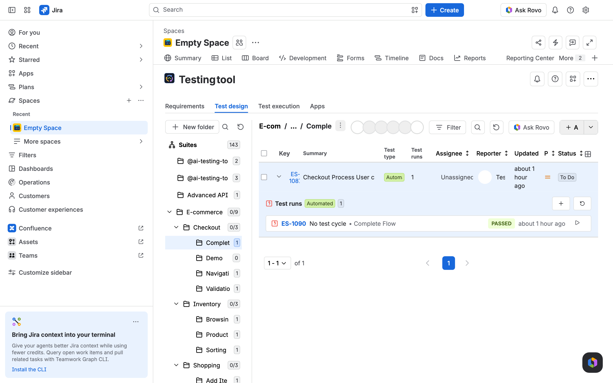

### 3.4. Đồng bộ Bản Ghi Thực Thi E2E (`Test execution`) & Các Bước `test.step` (`Test Pad`)
Trên tab **Test execution**, các bản ghi `Automated` **`PASSED`** (`ES-1085` … `ES-1101`) được ghi nhận đầy đủ; khi mở chi tiết **Test Pad (`ES-1090`)**, toàn bộ 5 bước `await test.step(...)` của Playwright được bóc tách trực tiếp vào mục **STEPS EXECUTION**:

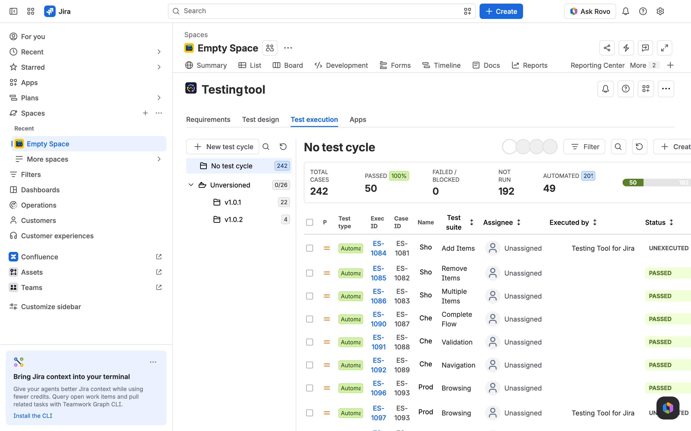

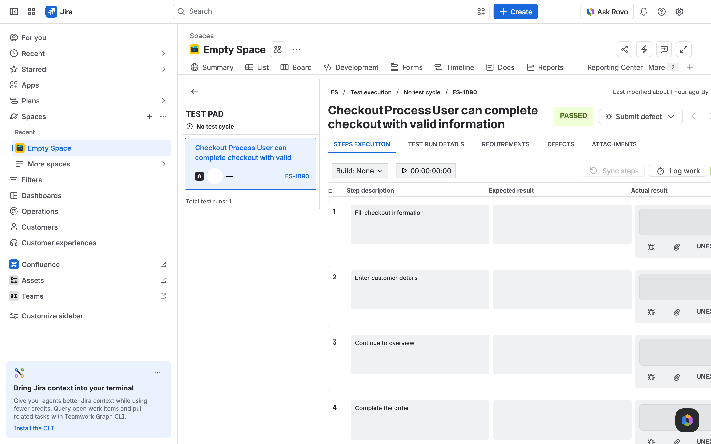

