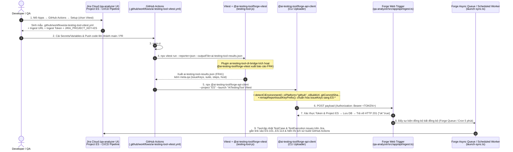

# Tài liệu & DEMO: Tích Hợp GitHub Actions (`testing-tool-js` ↔ `qa-analyzer` — Project `ES`)

Thư mục này chứa toàn bộ tài liệu kiến trúc, cấu hình, script chạy thử và bộ hình ảnh / video màn hình cho luồng CI/CD **GitHub Actions** giữa repository `testing-tool-js` (`https://github.com/ai-testing-tool/testing-tool-js`) và ứng dụng Jira Cloud `qa-analyzer` (`https://pipevo.atlassian.net/jira/software/projects/ES/...`, project key **`ES`**).

## Cấu trúc thư mục `docs/github-actions/`

| File / Thư mục | Mô tả |
| :--- | :--- |
| [`README.md`](./README.md) | Tài liệu phân tích luồng hoạt động, hướng dẫn cài đặt & hình ảnh DEMO từng bước |
| [`.env.example`](./.env.example) | Mẫu cấu hình `.env` để đẩy kết quả từ local lên Forge Web Trigger của project `ES` |
| [`demo-github-actions.sh`](./demo-github-actions.sh) | Script chạy Demo thực tế (`sh docs/github-actions/demo-github-actions.sh`) |
| [`media/demo_github_actions_flow.mp4`](./media/demo_github_actions_flow.mp4) | Video ghi màn hình toàn trình 5 bước (MP4) |
| [`media/demo_step1_jira_setup.png`](./media/demo_step1_jira_setup.png) | Ảnh Bước 1: Màn hình CI/CD Pipeline → GitHub Actions → Setup trên Jira (`ES`) |
| [`media/demo_step2_github_secrets.png`](./media/demo_step2_github_secrets.png) | Ảnh Bước 2: Cấu hình GitHub Secrets/Variables & file workflow |
| [`media/demo_step3_github_actions_run.png`](./media/demo_step3_github_actions_run.png) | Ảnh Bước 3: GitHub Actions thực thi job `test` và upload báo cáo FR41 |
| [`media/demo_step4_terminal_execution.png`](./media/demo_step4_terminal_execution.png) | Ảnh Bước 4: Kết quả thực thi script Demo trên Terminal |
| [`media/demo_step5_jira_builds_sync.png`](./media/demo_step5_jira_builds_sync.png) | Ảnh Bước 5: Màn hình CI/CD Pipeline → Builds & Traceability trên Jira (`ES`) |
| [`media/demo_jira_test_execution.png`](./media/demo_jira_test_execution.png) | Ảnh màn hình Test Execution trên Jira sau khi đồng bộ |

---

## 1. Sơ đồ luồng hoạt động End-to-End



---

## 2. Hình ảnh DEMO Từng Bước

### Bước 1: Lấy cấu hình CI/CD Template trên Jira (`Project ES`)
Trên Jira (`pipevo.atlassian.net` → Project **`ES`** → **Apps → GitHub Actions → Setup**), chọn framework **Vitest** để nhận mẫu [`.github/workflows/ai-testing-tool-vitest.yml`](../../.github/workflows/ai-testing-tool-vitest.yml) cùng danh sách Secrets/Variables:


---

### Bước 2: Thiết lập GitHub Secrets/Variables & File Workflow
Khai báo `AI_TESTING_TOOL_INGEST_URL`, `AI_TESTING_TOOL_INGEST_TOKEN` (Repository Secrets), `JIRA_PROJECT_KEY = ES` (Repository Variable) và thêm file [`.github/workflows/ai-testing-tool-vitest.yml`](../../.github/workflows/ai-testing-tool-vitest.yml):


---

### Bước 3: GitHub Actions thực thi Workflow `AiTestingTool Vitest #42`
Khi có `push` lên `main` hoặc `pull_request`, GitHub Actions chạy `npm ci`, chạy `npx vitest run --reporter=json --outputFile=ai-testing-tool-results.json` (xuất báo cáo FR41 với `195` tests, `197` steps) và upload qua `@ai-testing-tool/forge-api-client` (tự động ánh xạ `113` mã `ES-*` theo `--project ES`):


---

### Bước 4: Chạy lệnh Demo Thực Tế (`sh docs/github-actions/demo-github-actions.sh`)
Thực thi trực tiếp luồng GitHub Actions từ terminal:
```bash
sh docs/github-actions/demo-github-actions.sh
```


---

### Bước 5: Kết quả Đồng bộ Launch & Traceability trên Jira (`Project ES`)
Sau khi Forge Web Trigger (`ingest.ts`) trả về `HTTP 201 {"ok":true}`, worker `launch-sync.ts` đồng bộ các bản ghi **TestCase** & **TestExecution**, gắn link vào `ES-101` … `ES-114` và hiển thị trên màn hình **CI/CD Pipeline → Builds** và **Test Execution**:


